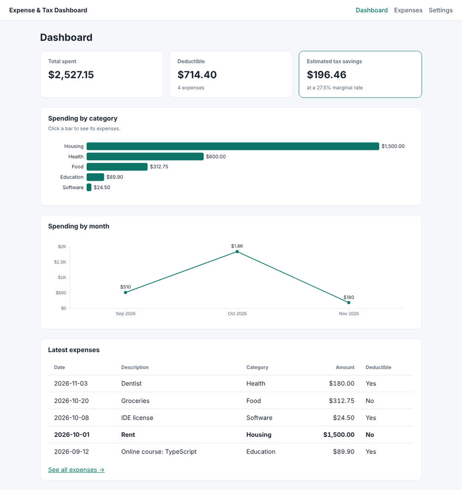

# Expense & Tax Dashboard

A personal learning project: a small single-page app to track expenses and estimate how much tax you save
with deductible ones. Built with **Vue 3 (Composition API)**, **TypeScript**, **Pinia**, **Vue Router**,
**D3** and **Vitest**.

**Live demo:** https://condao13.github.io/expense-tax-dashboard/



## Features

- Summary cards: total spent, deductible total and count, and estimated tax savings at a configurable marginal
  rate.
- Spending-by-category bar chart drawn with D3; click a bar (or Tab + Enter) to open that category's page.
- Spending-by-month line chart, also with D3.
- Add, edit and remove expenses with client-side validation; removal asks for confirmation in a reusable dialog.
- Filter by text, category, month and deductible-only, with a live total; expenses over 1,000 are shown in bold.
- Export the filtered expenses as CSV (quoted per RFC 4180, with spreadsheet formulas defused).
- Data saved in `localStorage` through a `useLocalStorage` composable, so it survives a page reload. Nothing is
  sent to a server.

## Technical decisions

- **Business logic as pure functions** (`src/utils/tax.ts`): totals, grouping, rounding to cents and
  validation have no Vue dependency, so they are trivial to test and reuse.
- **Pinia setup store** (`src/stores/expenses.ts`): one persisted ref from `useLocalStorage` holds the state,
  writable `computed`s expose its fields, `computed`s are the getters and functions are the actions.
- **D3 inside Vue** (`CategoryChart.vue`, `MonthlyChart.vue`): Vue owns the container element, D3 owns its
  contents. Drawing happens in `onMounted` and in a `flush: 'post'` watcher; a debounced `ResizeObserver`
  is cleaned up in `onBeforeUnmount`. D3 click and key events become a typed Vue `select` event.
- **Lazy-loaded routes**: the Expenses, Settings and Category pages are split into their own chunks; the
  category page reads `:name` with `useRoute()` and validates it with a type guard.
- **Hash history and relative `base`**, so the build runs on GitHub Pages without server configuration.

## Getting started

```bash
npm install
npm run dev        # http://localhost:5173
npm test           # unit and component tests (Vitest + Vue Test Utils)
npm run build      # type-check with vue-tsc and build to dist/
```

## Project structure

```
src/
  components/   SummaryCards, ExpenseForm, ExpenseTable, ConfirmDialog, CategoryChart, MonthlyChart (+ tests)
  composables/  useCurrency (Intl formatting), useLocalStorage (+ test)
  router/       routes, three of them lazy-loaded
  stores/       Pinia store (+ test)
  utils/        pure tax, CSV and date functions (+ tests)
  views/        Dashboard, Expenses, Category, Settings
```

## Deployment

Every push to `main` runs `.github/workflows/deploy.yml`: it installs dependencies, runs the tests, builds the
app and publishes `dist/` to GitHub Pages.
